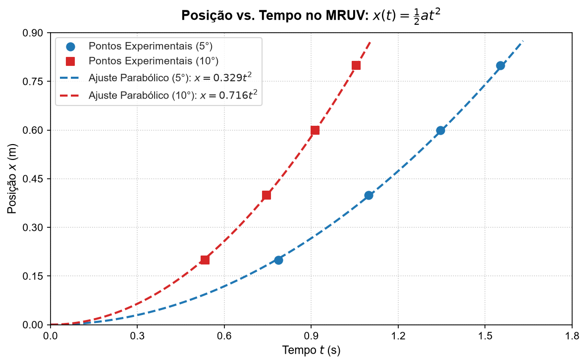
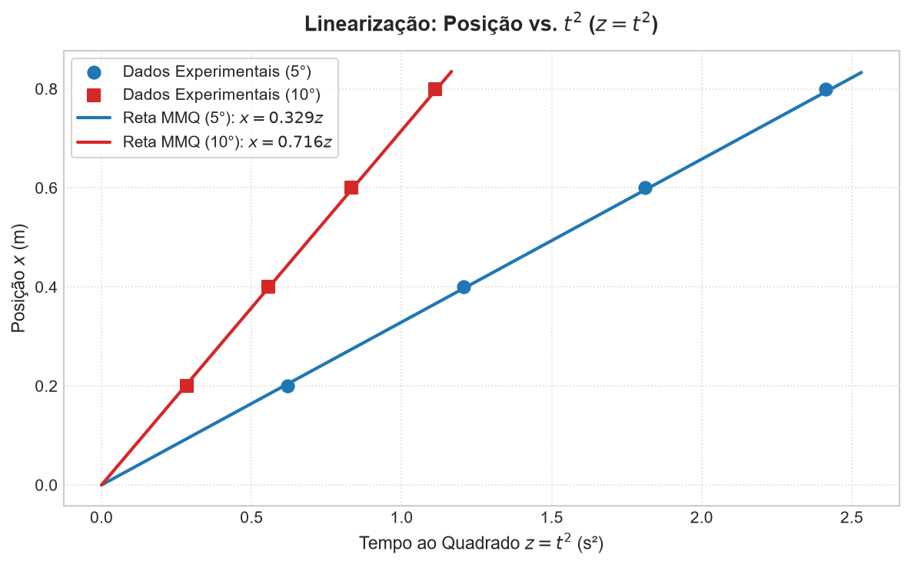

# 🏎️ MRUV no Plano Inclinado - Estudo Cinematográfico e Ajuste por Mínimos Quadrados

[](https://www.python.org/)
[](#)
[](#)

Este repositório contém a análise experimental do **Movimento Retilíneo Uniformemente Variado (MRUV)** para um móvel deslizando em um **Trilho de Ar** em plano inclinado sob ação da aceleração da gravidade, com dados registrados por fotosensores.

Inclui equações cinemáticas ponto a ponto ($x(t)$, $v(t)$, Torricelli), regressão por **Mínimos Quadrados (MMQ)** com a variável linearizada $z = t^2$, e um relatório visual interativo em HTML.

---

## 📌 Objetivos

1. Analisar a variação da posição $x$ em função do tempo $t$ para inclinações de $5^\circ$ e $10^\circ$.
2. Aplicar o método de **linearização de variáveis** ($z = t^2$) para ajustar uma reta $x(z) = C \cdot z + b$.
3. Determinar a aceleração experimental do móvel ($a_{\text{exp}} = 2C$) e comparar com o valor teórico ($a_{\text{teór}} = g \cdot \sin\theta$).
4. Calcular o erro relativo percentual ($E_r\%$) e avaliar a precisão metrológica das medições.

---

## 📐 Fundamentação Teórica

### Equação Horária da Posição
No MRUV com posição inicial $x_0 = 0$ e velocidade inicial $v_0 = 0$:

$$x(t) = \frac{1}{2} a t^2$$

### Linearização pelo Método dos Mínimos Quadrados (MMQ)
Definindo uma nova variável $z_i = t_i^2$, a equação transforma-se na forma linear:

$$x(z) = C \cdot z + b \quad \text{onde} \quad C = \frac{1}{2} a$$

A inclinação $C$ da reta de ajuste é dada por:

$$C = \frac{\sum (z_i - \bar{z})(x_i - \bar{x})}{\sum (z_i - \bar{z})^2}$$

A aceleração experimental é então obtida por:

$$a_{\text{exp}} = 2 \cdot C$$

### Aceleração Teórica e Erro Relativo
Negligenciando o atrito no trilho de ar, a aceleração teórica é dada por:

$$a_{\text{teór}} = g \cdot \sin(\theta)$$

O Erro Relativo Percentual é calculado por:

$$E_r\% = \frac{|a_{\text{exp}} - a_{\text{teór}}|}{a_{\text{teór}}} \times 100\%$$

---

## 📊 Dados Experimentais Coletados

### Experimento 1: Inclinação de 5° ($\theta = 5^\circ$)
- Aceleração Teórica: $a_{\text{teór}} = 9,81 \cdot \sin(5^\circ) \approx 0,855 \text{ m/s}^2$

| Ponto | Posição $x$ ($\text{m}$) | Tempo $t$ ($\text{s}$) | $z = t^2$ ($\text{s}^2$) |
| :---: | :---: | :---: | :---: |
| 1 | 0,20 | 0,787 | 0,619 |
| 2 | 0,40 | 1,098 | 1,206 |
| 3 | 0,60 | 1,346 | 1,812 |
| 4 | 0,80 | 1,553 | 2,412 |

### Experimento 2: Inclinação de 10° ($\theta = 10^\circ$)
- Aceleração Teórica: $a_{\text{teór}} = 9,81 \cdot \sin(10^\circ) \approx 1,7035 \text{ m/s}^2$

| Ponto | Posição $x$ ($\text{m}$) | Tempo $t$ ($\text{s}$) | $z = t^2$ ($\text{s}^2$) |
| :---: | :---: | :---: | :---: |
| 1 | 0,20 | 0,533 | 0,284 |
| 2 | 0,40 | 0,745 | 0,555 |
| 3 | 0,60 | 0,913 | 0,834 |
| 4 | 0,80 | 1,054 | 1,111 |

---

## 📈 Resultados Obtidos

| Inclinação ($\theta$) | Coeficiente $C$ ($\text{m/s}^2$) | Aceleração Exp. $a_{\text{exp}}$ ($\text{m/s}^2$) | Aceleração Teór. $a_{\text{teór}}$ ($\text{m/s}^2$) | Erro Relativo ($E_r\%$) |
| :---: | :---: | :---: | :---: | :---: |
| **5°** | $0,329$ | $0,658 \text{ m/s}^2$ | $0,855 \text{ m/s}^2$ | $23,04\%$ |
| **10°** | $0,716$ | $1,432 \text{ m/s}^2$ | $1,7035 \text{ m/s}^2$ | $15,94\%$ |

---

## 🖼️ Visualizações Gráficas

### 1. Posição vs. Tempo (Ajuste Parabólico)


### 2. Linearização Posição vs. $t^2$ (Ajuste MMQ)


### 🌐 Relatório HTML Interativo
Você também pode abrir o relatório interativo completo em [`docs/relatorio_mruv.html`](docs/relatorio_mruv.html) diretamente no navegador para interagir com a visualização Vega-Lite e alternar entre os ângulos de inclinação.

---

## 🗂️ Estrutura do Repositório

```text
mruv-plano-inclinado/
├── README.md                      # Documentação principal do repositório
├── requirements.txt               # Dependências Python
├── .gitignore                     # Arquivos ignorados pelo Git
├── data/
│   ├── especificacao_mruv.json    # Schema metrológico e dataset JSON
│   └── dados_mruv.csv             # Tabela de dados em formato CSV
├── src/
│   ├── calculos_cinematica.py     # Resolução ponto a ponto e geração dos gráficos estáticos
│   └── mruv_interativo.py         # Processamento MMQ e geração da página HTML interativa
├── docs/
│   └── relatorio_mruv.html        # Relatório de visualização interativa HTML (Vega-Lite)
└── assets/
    ├── grafico_posicao_tempo.png  # Imagem da curva parabólica x(t)
    └── grafico_linearizacao.png   # Imagem da curva linearizada x(z)
```

---

## 💻 Como Executar o Projeto

### 1. Clonar o repositório
```bash
git clone https://github.com/jAk7star/mruv-plano-inclinado.git
cd mruv-plano-inclinado
```

### 2. Instalar dependências
```bash
pip install -r requirements.txt
```

### 3. Executar os cálculos e gerar gráficos estáticos
```bash
python src/calculos_cinematica.py
```

### 4. Gerar relatório HTML interativo
```bash
python src/mruv_interativo.py
```

